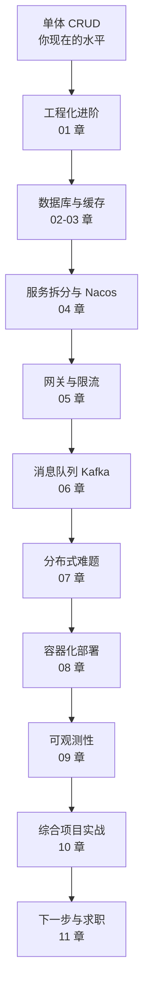

# Java 后端进阶路线：从 CRUD 到微服务

> 写给"已经会写增删改查，但看不懂公司后端架构"的你。

你已经能用 Spring Boot 写出记事本、待办事项、商品管理的 CRUD 接口了。这是很好的起点——**说明你已经跨过了"语法关"和"框架入门关"**。但当你打开公司的代码仓库，看到 Nacos、Kafka、Feign、Gateway、Sentinel、Redis、Docker 这些名词时，很容易产生一种"我学的东西是不是白学了"的错觉。

事实恰恰相反：**这些技术全都是在 CRUD 的基础上，为了解决"人多了、流量大了、系统多了"之后出现的问题而发明的**。你缺的不是从零开始的新知识，而是一张地图，以及一次次"把老问题放大，看新工具怎么解决"的动手实验。

这套教程就是那张地图。

---

## 这套教程适合谁

- 学过 Java 基础、MySQL 基础、Spring MVC / Spring Boot
- 能独立完成单表或简单多表的增删改查
- 没接触过微服务、消息队列、缓存、容器化
- 希望达到"能看懂公司项目、能参与模块开发、面试能讲清楚"的水平

**不适合**：完全没有 Java 基础的人；已经有 2 年以上微服务经验、想深入源码的人。

---

## 学完之后你能做到什么

1. 说清楚公司架构里每个组件**为什么存在**，而不是只会背名词。
2. 独立搭建一套本地微服务环境：Nacos + Gateway + 多个 Spring Boot 服务 + Redis + Kafka + MySQL。
3. 完成一个可运行的"微服务小电商"：用户、商品、订单、库存四个服务，包含缓存、消息、限流、链路追踪。
4. 面试时能把项目讲成"我遇到了什么问题、比较了哪些方案、最后怎么落地"。
5. 知道下一步该学什么，不再被技术名词牵着走。

---

## 版本基线（非常重要）

Spring 生态最劝退新人的不是概念，而是**版本不匹配**。本教程统一使用下面这套经过验证的组合，请务必严格对照：

| 组件 | 版本 | 说明 |
|---|---|---|
| JDK | 17 | Spring Boot 3 的最低要求 |
| Maven | 3.8+ | |
| Spring Boot | 3.2.4 | 基线版本 |
| Spring Cloud | 2023.0.1 | 代号 Leyton |
| Spring Cloud Alibaba | 2023.0.1.0 | 与上面的 Boot / Cloud 对齐 |
| MyBatis-Plus | 3.5.5 | |
| MySQL | 8.0 | |
| Redis | 7.2 | |
| Nacos | 2.3.2 | |
| Kafka | 3.7.0 | KRaft 模式，不依赖 ZooKeeper |
| Docker Desktop | 24+ | Windows 上建议开启 WSL2 |

> 原则：**不要单独升级某一个组件的版本**。要升就查官方版本对照表，整套一起升。版本冲突是新手 80% 的"玄学报错"来源。

---

## 学习路线图



注意顺序：**先工程化，再中间件，最后微服务**。很多教程一上来就讲 Nacos，结果学员连统一异常处理都没写过，服务拆出来只会更乱。

---

## 章节索引

| 章节 | 标题 | 预计用时 | 核心产出 |
|---|---|---|---|
| [00](00-全景图.md) | 全景图：从 CRUD 到微服务 | 3h | 画出技术地图，理解每个组件的职责 |
| [01](01-SpringBoot工程化进阶.md) | Spring Boot 工程化进阶 | 6h | 一套规范的后端项目骨架 |
| [02](02-MySQL索引与事务.md) | MySQL 进阶：索引与事务 | 8h | 会看执行计划，能定位慢查询 |
| [03](03-Redis缓存实战.md) | Redis 缓存实战 | 8h | 商品缓存 + 分布式锁 |
| [04](04-微服务拆分与Nacos.md) | 微服务拆分与 Nacos | 10h | 三个服务互相调用 |
| [05](05-Gateway与Sentinel.md) | Gateway 与 Sentinel | 8h | 统一入口 + 限流熔断 |
| [06](06-Kafka消息队列.md) | Kafka 消息队列 | 10h | 下单异步扣库存 + 积分 |
| [07](07-分布式难题与方案.md) | 分布式难题与方案 | 8h | 幂等、分布式 ID、事务方案 |
| [08](08-Docker与部署.md) | Docker 与部署 | 8h | 一条命令拉起全套环境 |
| [09](09-可观测性.md) | 可观测性 | 6h | 日志 traceId + 监控指标 |
| [10](10-项目实战-微服务小电商.md) | 项目实战：微服务小电商 | 20h | 完整可运行项目 |
| [11](11-下一步与求职准备.md) | 下一步与求职准备 | 4h | 90 天成长计划 |
| [附录](附录-命令速查与排错手册.md) | 命令速查与排错手册 | 随时查 | 常用命令、报错对照 |

预计总学时 **95-100 小时**。按每周 8-12 小时计算，约 **9-10 周**。

---

## 建议的每周计划

| 周次 | 内容 | 里程碑 |
|---|---|---|
| 第 1 周 | 00 + 01 | 能说清微服务全景；搭出规范项目骨架 |
| 第 2 周 | 02 | 能对一条慢 SQL 做分析和优化 |
| 第 3 周 | 03 | 给商品接口加上缓存和分布式锁 |
| 第 4 周 | 04 | 订单服务能通过 Feign 调到商品服务 |
| 第 5 周 | 05 | 所有请求统一走 Gateway，并配置限流 |
| 第 6 周 | 06 | 下单后通过 Kafka 异步处理积分 |
| 第 7 周 | 07 | 下单接口具备幂等性，能解释分布式事务方案 |
| 第 8 周 | 08 | `docker compose up` 一键启动全部环境 |
| 第 9 周 | 09 + 10（前半） | 日志能串起一次请求；项目主线跑通 |
| 第 10 周 | 10（后半）+ 11 | 项目验收 + 简历与面试准备 |

**如果时间不够，宁可慢，不要跳。** 每章的"动手实验"必须自己敲一遍。

---

## 怎么使用这套教程

每章统一结构：

1. **学习目标**：读完你能做什么
2. **它在公司里解决什么问题**：先建立动机，再看技术
3. **核心概念**：表格和图，不求背，求理解
4. **动手实验**：可复制的命令和配置
5. **完整代码**：不写伪代码
6. **常见坑**：别人踩过的，你别踩
7. **练习题**：检验是否真的会了
8. **小结**：三句话回顾

### 三条学习原则

1. **先跑通，再理解，最后优化。** 不要一开始就纠结源码，先让程序动起来。
2. **每个技术都问三个问题**：它解决什么问题？不用它会怎样？它引入了什么新问题？
3. **以项目为主线。** 所有零散实验最终都要回到第 10 章的项目里。学一个技术，就把它接进项目一次。

---

## 环境准备清单（第 0 周完成）

### 必装

- [ ] JDK 17（推荐 Temurin 17 或 Oracle JDK 17）
- [ ] Maven 3.8+
- [ ] IntelliJ IDEA（社区版够用，旗舰版对 Spring 支持更好）
- [ ] Docker Desktop（Windows 需开启 WSL2）
- [ ] Git
- [ ] 一个 API 调试工具：Apifox / Postman / curl

### 验证命令

```bash
java -version        # 应显示 17.x
mvn -v               # 应显示 Maven 3.8+
docker --version     # 应显示 24.x 或更高
docker compose version
git --version
```

### 提前拉取镜像（国内网络建议配置镜像加速）

```bash
docker pull mysql:8.0
docker pull redis:7.2
docker pull nacos/nacos-server:v2.3.2
docker pull bitnami/kafka:3.7
```

> 如果 Docker Hub 拉取慢，请在 Docker Desktop 的 Settings → Docker Engine 中配置国内镜像加速地址，或使用公司内网镜像仓库。

### 代码放哪里

教程配套的可运行环境在：

```text
java-advanced-roadmap/
├── README.md
├── 00-全景图.md ~ 11-下一步与求职准备.md   # 各章正文，代码内嵌在对应章节
├── 附录-命令速查与排错手册.md              # 命令与排错速查
└── docker/
    ├── docker-compose.yml              # 一键启动 MySQL/Redis/Nacos/Kafka/Sentinel
    ├── observability-compose.yml       # 可选：Prometheus/Grafana/Zipkin
    ├── mysql/init.sql                  # 初始化数据库、表、示例数据
    └── prometheus/prometheus.yml       # Prometheus 抓取配置
```

每章的完整代码直接写在正文里，按"目录 → 文件 → 代码"的顺序给出，复制即可使用。先不要急着把所有代码抄一遍，学到哪章再敲哪章。

---

## 一个重要的心态提醒

公司里那些"好多技术"，单独拿出来都不难。真正难的是：

- 知道**什么时候该用**，什么时候不该用；
- 知道**用了之后会引入什么问题**；
- 出了问题能**定位**。

所以本教程不会只告诉你"Nacos 是做服务注册的"，还会告诉你"为什么单体时代不需要它""它挂了会怎样""怎么排查服务没注册上"。

准备好了就开始 [第 00 章：全景图](00-全景图.md)。

---

## 附：本教程不覆盖的内容

为了控制范围，以下内容只做概念介绍或给出学习方向，不展开：

- Kubernetes（第 11 章给学习路径）
- Service Mesh（Istio 等）
- 大数据生态（Flink、Spark）
- JVM 深度调优
- Spring 源码逐行分析

这些不是不重要，而是**现阶段学了也用不上**。先把主干走通，再挑方向深入。
